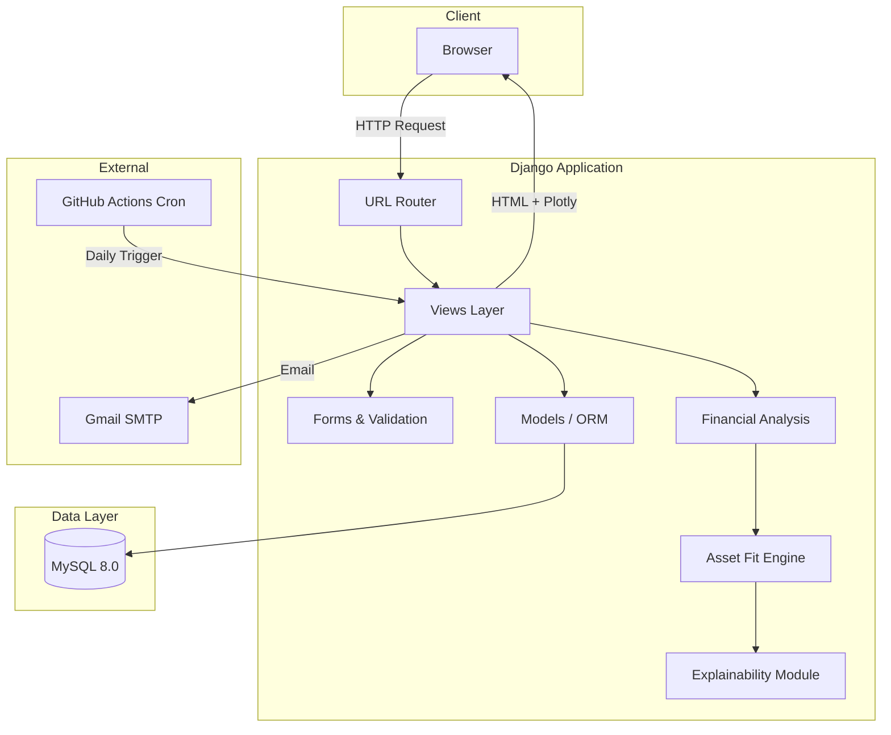
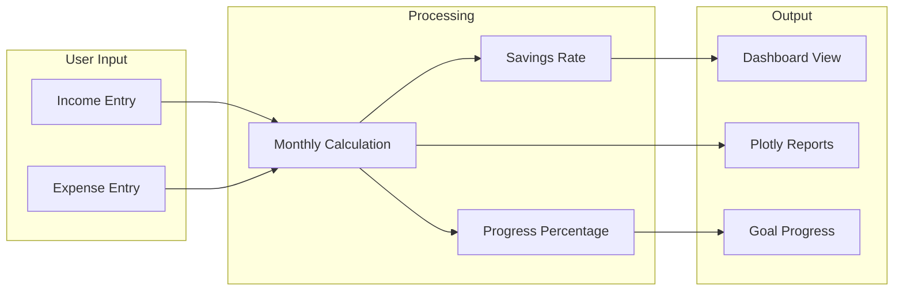
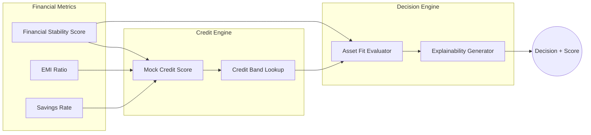
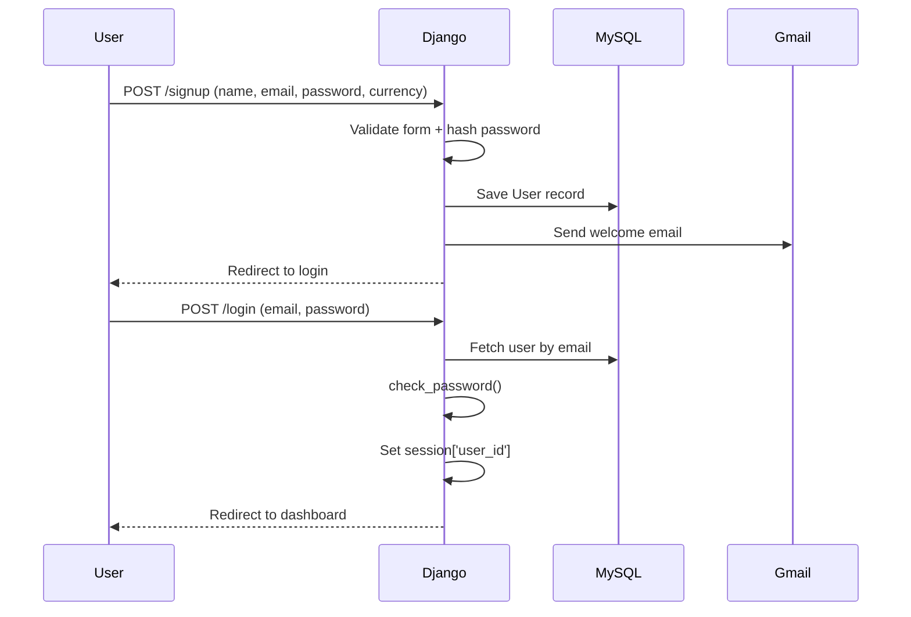
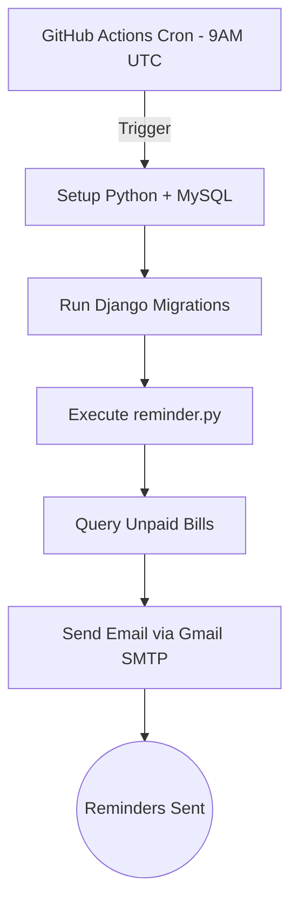
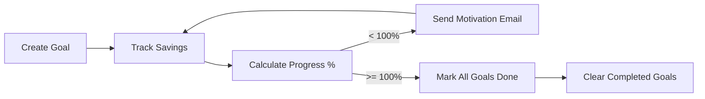

<div align="center">


<br/>

[](https://github.com/)

<br/>

<a href="https://figma.com/">
  
</a>

<br/><br/>


<br/><br/>

```text
💰 TRACK INCOME  →  📊 MANAGE EXPENSES  →  🎯 SET GOALS  →  📈 GROW WEALTH
```

</div>

---

> **Wealth-Wise** · Comprehensive Personal Finance & Expense Intelligence Platform  
> **Platform Status:** Operational  
> **Architecture:** Full Stack Django Monolith + MySQL  

Wealth-Wise empowers users to take full control of their financial lifecycle — from tracking income and expenses with multi-currency support, managing recurring bills with automated email reminders, setting and monitoring financial goals, to generating rich interactive reports powered by Plotly — all wrapped in a sleek cyberpunk dark-mode UI.

<div align="center">

| 💰 Income & Expenses | 🎯 Goal Engine | 📋 Bill Tracker | 📊 Financial Reports |
|:---:|:---:|:---:|:---:|
| Categorized tracking | Savings-linked targets | Due date management | Plotly bar/line/pie |
| Monthly breakdown | Progress percentage | Mark as paid | Monthly trend analysis |
| Multi-currency | Email notifications | Auto-reminders (CI/CD) | Expense categorization |

</div>

---

## Table of Contents

<details open>
<summary><b>Navigate</b></summary>

| # | Section | # | Section |
|---:|---|---:|---|
| 1 | [Overview](#1-overview) | 6 | [Architecture & Workflows](#6-architecture--workflows) |
| 2 | [Problem Statement](#2-problem-statement) | 7 | [Repository Structure](#7-repository-structure) |
| 3 | [Links & Credentials](#3-links--credentials) | 8 | [Authentication](#8-authentication) |
| 4 | [Features & Deliverables](#4-features--deliverables) | 9 | [Setup (Local)](#9-setup-local) |
| 5 | [Technology Stack](#5-technology-stack) | 10 | [Screenshots](#10-screenshots) |

</details>

---

## 1. Overview

**Wealth-Wise** is a full-stack, cyberpunk-themed personal finance management application designed to map the entire financial lifecycle of a user — from daily transactions to long-term wealth goals.

| Capability | What it does |
|---|---|
| Income & Expense Dashboard | Monthly transaction tracking with categorized emoji-tagged entries and savings calculations. |
| Multi-Currency Support | Users select their preferred currency at signup — all financial data is scoped accordingly. |
| Financial Goal Tracker | Set financial targets, link them to savings progress, receive email notifications on milestones. |
| Bill Management System | Add, track, and mark bills as paid with automatic email reminders via GitHub Actions CI/CD. |
| Interactive Financial Reports | Yearly reports with Plotly-powered bar charts, line graphs, and pie charts for expense breakdowns. |
| Asset Fit Engine | Rule-based engine evaluating Gold/REIT investment suitability based on financial stability scores. |
| Explainability Module | Human-readable explanations for financial decisions with risk assessments and recommendations. |

Stack shape: **JavaScript + HTML + CSS + Tailwind** frontend · **Django 5.1** backend · **MySQL 8.0** database · **Plotly 6.0** charts · Session Authentication · Dark Mode UI.

---

## 2. Problem Statement

### Smart Personal Finance Management for the Everyday User

**Problem Abstract**
Millions of individuals struggle with financial visibility — lacking clear insights into their income, expenses, savings patterns, and progress toward financial goals. Information is scattered across bank statements, manual spreadsheets, and mental notes. Most existing tools are either too complex or too simplistic.

Wealth-Wise addresses this by providing:
1. A centralized dashboard for income and expense tracking across 30+ predefined categories with emoji-tagged identification.
2. A goal engine that links financial targets to actual savings, providing real-time progress tracking with motivational email nudges.
3. A bill management system with automated daily reminders (GitHub Actions cron) to prevent missed payments.
4. Rich financial reports with interactive Plotly visualizations showing monthly trends, category breakdowns, and income vs. expense comparisons.
5. An asset fit engine with explainability layer for investment readiness assessment (Gold/REITs).

**Expected Outcomes**
- `→` Categorized income & expense tracking with monthly breakdowns across all 12 months
- `→` Savings rate calculation and progress visualization
- `→` Financial goal setting with milestone notifications via email
- `→` Bill tracking with paid/unpaid status and automated reminders
- `→` Interactive Plotly reports: bar charts, line graphs, and pie charts
- `→` Multi-currency support (50+ currencies seeded via management command)
- `→` Asset fitness evaluation with human-readable explainability

**Evaluation Criteria Mapping**
| Criteria | Implementation in Wealth-Wise |
|:---|:---|
| **Understanding of Problem** | Directly targets everyday users who lack financial visibility, providing a centralized cyberpunk-themed dashboard for complete financial lifecycle management. |
| **Proposed Approach** | Django 5.1 + MySQL monolith with Plotly-powered interactive reports, session-based auth, automated CI/CD bill reminders, and a rule-based asset fit engine. |
| **Market Fit & Relevance** | Addresses the gap between overly complex finance apps and basic spreadsheets, with a visually striking dark-mode UI, multi-currency support, and gamified goal tracking. |

---

## 3. Links & Credentials

| Resource | Link / note |
|---|---|
| Full stack + database | Local — Django `:8000` + MySQL |
| Local API | `http://127.0.0.1:8000` |
| Admin Panel | `http://127.0.0.1:8000/admin` |
| Email Service | `wealthwise200@gmail.com` (SMTP via Gmail) |

### Demo Access (Local)
Seed the database with currencies using `python manage.py currencies`, then sign up through the registration form.

| Page | URL Route | Description |
|---|---|---|
| Landing Page | `/` | Home / marketing page |
| Signup & Login | `/WW/signup/` | Dual-form auth (login + signup) |
| Dashboard | `/WW/i1.html/` | Income & expense management |
| Goals | `/WW/G.html/` | Financial goal tracker |
| Bills | `/WW/b1.html/` | Bill management |
| Reports | `/WW/report.html/` | Plotly-powered financial reports |

---

## 4. Features & Deliverables

### Core Features

| # | Feature | Status |
|---:|---|:---:|
| 01 | Email/Password Signup & Login (Session Auth) | ✅ |
| 02 | OTP-based Password Recovery (Email) | ✅ |
| 03 | Multi-Currency Selection (50+ currencies) | ✅ |
| 04 | Income Tracking (6 categories with emoji tags) | ✅ |
| 05 | Expense Tracking (30 categories with emoji tags) | ✅ |
| 06 | Monthly Financial Dashboard (savings, percentages) | ✅ |
| 07 | Financial Goal Engine (progress tracking) | ✅ |
| 08 | Bill Management System (add, pay, delete) | ✅ |
| 09 | Interactive Reports (Plotly bar/line/pie) | ✅ |
| 10 | Asset Fit Engine (Gold/REIT evaluation) | ✅ |
| 11 | Explainability Module (human-readable decisions) | ✅ |

### Bonus Features

| # | Feature | Status |
|---:|---|:---:|
| B1 | Cyberpunk Dark Mode UI (Green Neon theme) | ✅ |
| B2 | Automated Bill Reminders (GitHub Actions Cron) | ✅ |
| B3 | Welcome & Goal Achievement Email Notifications | ✅ |
| B4 | Motivational Progress Emails | ✅ |
| B5 | Currency Seeder Management Command | ✅ |
| B6 | FAQ, Privacy Policy, Terms, Security, Support Pages | ✅ |

---

## 5. Technology Stack

<div align="center">

</div>

<br/>

<div align="center">


</div>

<br/>

| Layer | Technology | Purpose |
|---|---|---|
| **Backend** | Django 5.1.4 (Python 3.11) | REST views, session auth, business logic |
| **Database** | MySQL 8.0 (utf8mb4) | Persistent storage for users, transactions, goals, bills |
| **Frontend** | JavaScript ES6 + HTML5 + CSS3 | Dynamic UI interactions and DOM manipulation |
| **Styling** | Tailwind CSS + Custom CSS | Cyberpunk dark theme with green neon accents |
| **Charts** | Plotly 6.0 | Interactive bar, line, and pie chart visualizations |
| **PDF** | xhtml2pdf + ReportLab | Financial report PDF generation |
| **Email** | Django SMTP (Gmail) | Transactional emails for signup, OTP, goals, reminders |
| **CI/CD** | GitHub Actions | Daily automated bill reminder cron job |
| **QR** | qrcode library | QR code generation |

---

## 6. Architecture & Workflows

### 6.1 Overall System Architecture


### 6.2 Financial Data Pipeline


### 6.3 Asset Fit Decision Engine


### 6.4 Authentication & Session Flow


### 6.5 Automated Bill Reminder Pipeline


### 6.6 Goal Tracking Lifecycle


---

## 7. Repository Structure

```text
WealthWise/
├── .github/
│   └── workflows/
│       └── reminder.yml          # GitHub Actions cron for daily bill reminders
├── p/                            # Django project root
│   ├── manage.py                 # Django CLI entry point
│   ├── requirements.txt          # Python dependencies (74 packages)
│   ├── db.sqlite3                # SQLite fallback (dev)
│   ├── p/                        # Django project config
│   │   ├── settings.py           # Django settings (MySQL, SMTP, Tailwind)
│   │   ├── urls.py               # Root URL configuration
│   │   ├── views.py              # Base views
│   │   ├── wsgi.py               # WSGI entry point
│   │   └── asgi.py               # ASGI entry point
│   ├── WW/                       # Main application module
│   │   ├── models.py             # User, Income, Expense, Bill, Goal, Currency
│   │   ├── views.py              # 20+ view functions (571 LOC)
│   │   ├── forms.py              # 8 Django forms with validation
│   │   ├── urls.py               # 18 URL routes
│   │   ├── admin.py              # Admin registration
│   │   ├── financial_analysis.py # Stability score, savings rate, EMI ratio
│   │   ├── asset_fit_engine.py   # Gold/REIT investment fitness evaluator
│   │   ├── explainability.py     # Human-readable financial decision explanations
│   │   ├── management/
│   │   │   └── commands/
│   │   │       ├── currencies.py # Seed 50+ world currencies
│   │   │       └── reminder.py   # Automated bill reminder emails
│   │   └── templates/WW/        # 15 HTML templates
│   │       ├── home.html         # Landing page
│   │       ├── signup.html       # Login + signup dual form
│   │       ├── i1.html           # Income & expense dashboard
│   │       ├── G.html            # Goal tracker
│   │       ├── b1.html           # Bill management
│   │       ├── report.html       # Plotly financial reports
│   │       ├── forgot-password.html
│   │       ├── verify-otp.html
│   │       ├── FAQ.html
│   │       ├── privacy.html
│   │       ├── security.html
│   │       ├── terms.html
│   │       ├── support.html
│   │       ├── fiscalpilot_choose_asset.html
│   │       └── fiscalpilot_decision_result.html
│   ├── static/                   # Static assets
│   │   ├── home.css / home.js    # Landing page styles & scripts
│   │   ├── i1.css                # Dashboard styles
│   │   ├── G.css                 # Goal tracker styles
│   │   ├── b1.css                # Bill management styles
│   │   ├── report.css            # Report styles
│   │   ├── signup.css            # Auth page styles
│   │   ├── forgot-password.css   # Password recovery styles
│   │   ├── FAQ.css / support.css # Info page styles
│   │   ├── styles.css            # Global stylesheet
│   │   ├── logoWw.jpg            # Wealth-Wise logo
│   │   └── *.svg                 # Social media icons
│   ├── templates/website/        # Base templates
│   └── theme/                    # Tailwind CSS theme app
│       ├── static/               # Compiled Tailwind output
│       └── static_src/           # Tailwind source config
└── README.md                     # This file
```

---

## 8. Authentication

Authentication is handled securely via **Django's Session framework** for traditional email/password logins. Passwords are hashed using Django's `make_password` / `check_password` utilities with PBKDF2 by default.

| Feature | Implementation |
|---|---|
| **Signup** | Email, name, password (regex-enforced), currency selection |
| **Login** | Email + password verification against hashed store |
| **Session** | `request.session['user_id']` for stateful access control |
| **Logout** | Session flush with cache-busting headers |
| **Password Recovery** | OTP via email (1-minute expiry) → new password reset |
| **Transactional Emails** | Welcome email on signup, OTP delivery, goal notifications |

Password requirements enforced via regex:
```text
^(?=.*[a-z])(?=.*[A-Z])(?=.*\d)(?=.*[@$!%?&])[A-Za-z\d@$!%?&]{8,}$
```

---

## 9. Setup (Local)

1. **Clone the repository:**
   ```bash
   git clone https://github.com/your-username/WealthWise.git
   cd WealthWise
   ```

2. **Backend Setup:**
   ```bash
   cd p
   python -m venv venv
   source venv/bin/activate  # On Windows: venv\Scripts\activate
   pip install -r requirements.txt
   ```

3. **Database Setup (MySQL):**
   ```sql
   CREATE DATABASE wealthwise CHARACTER SET utf8mb4 COLLATE utf8mb4_unicode_ci;
   ```
   Update `p/settings.py` with your MySQL credentials:
   ```python
   DATABASES = {
       'default': {
           'ENGINE': 'django.db.backends.mysql',
           'NAME': 'wealthwise',
           'USER': 'root',
           'PASSWORD': 'your_password',
           'HOST': 'localhost',
           'PORT': '3306',
       }
   }
   ```

4. **Run Migrations & Seed Currencies:**
   ```bash
   python manage.py migrate
   python manage.py currencies
   ```

5. **Start the Development Server:**
   ```bash
   python manage.py runserver
   ```
   *Navigate to `http://127.0.0.1:8000` in your browser.*

---

## 10. Screenshots

<details>
<summary><b>🚀 Landing Page</b></summary>
<br/>
<i>Cyberpunk dark theme landing page with green neon accents</i>
</details>

<details>
<summary><b>🔐 Signup & Login</b></summary>
<br/>
<i>Dual-form authentication page with password strength validation</i>
</details>

<details>
<summary><b>📊 Income & Expense Dashboard</b></summary>
<br/>
<i>Monthly transaction tracker with savings percentage and category breakdowns</i>
</details>

<details>
<summary><b>🎯 Financial Goal Tracker</b></summary>
<br/>
<i>Goal setting with progress bars linked to actual savings</i>
</details>

<details>
<summary><b>📋 Bill Management</b></summary>
<br/>
<i>Bill tracker with paid/unpaid status and automated daily reminders</i>
</details>

<details>
<summary><b>📈 Financial Reports</b></summary>
<br/>
<i>Interactive Plotly charts — bar, line, and pie visualizations</i>
</details>

---

<div align="center">


<br/>

<i>Built with 💚 by the Wealth-Wise Team</i>

<br/><br/>


</div>
